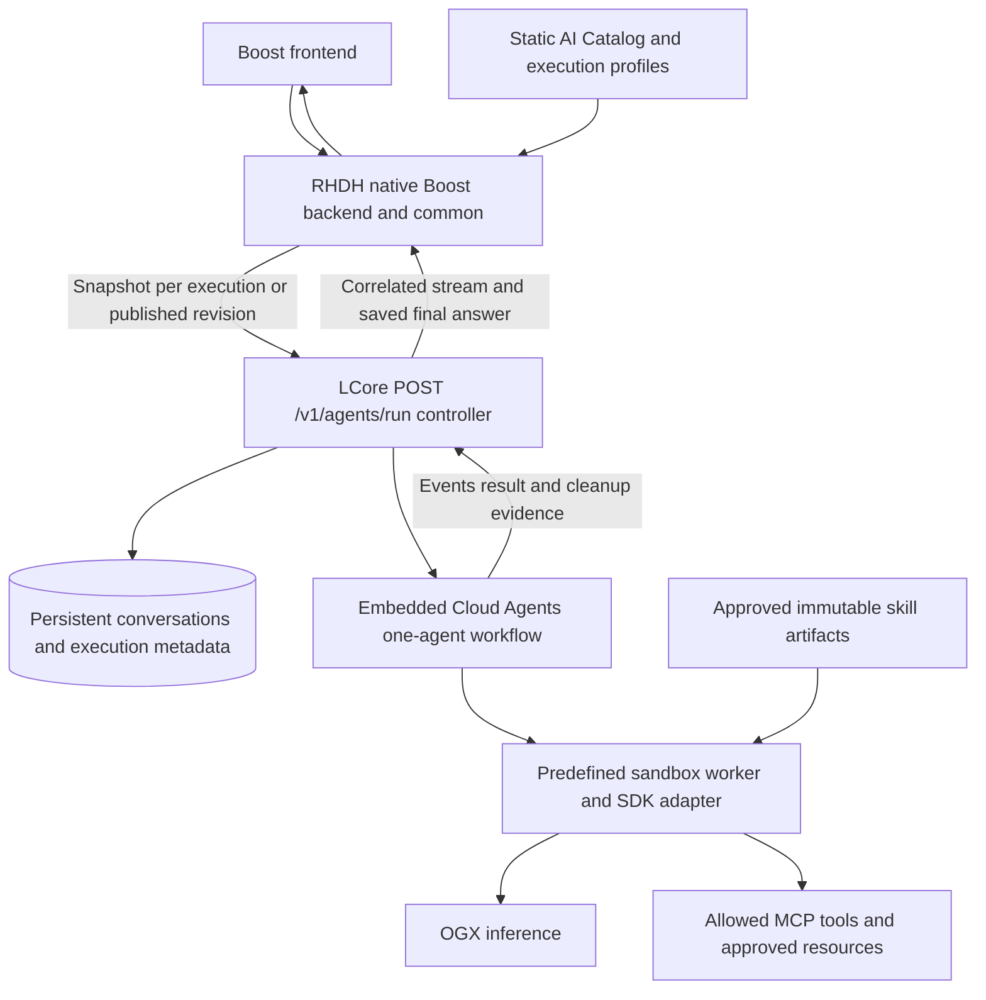

# RHDH LCore and Cloud Agents architecture

Proposed RHDH 2.2 static single-agent execution. The controller is hosted in LCore; cross-agent handoffs are disabled.

The SDK adapter belongs to the LCore integration. The compatible executor/worker interface is an implementation gate. Static spawn settings control provisioning; the query cannot alter them. Execution configuration is runtime input and is not saved or pinned in conversation history. History stores messages and agent/run attribution.
