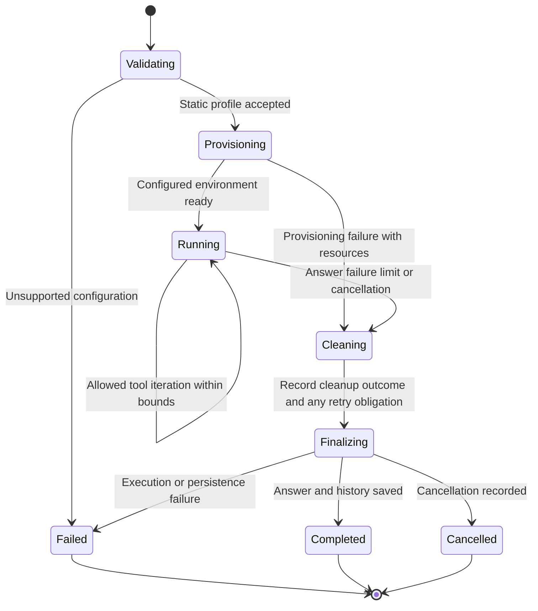

# Execution lifecycle

Cleanup failure is linked to the run and reconciled with bounded policy; it is never silently treated as destroyed. A completed answer and outstanding cleanup obligation are distinct stored states.
