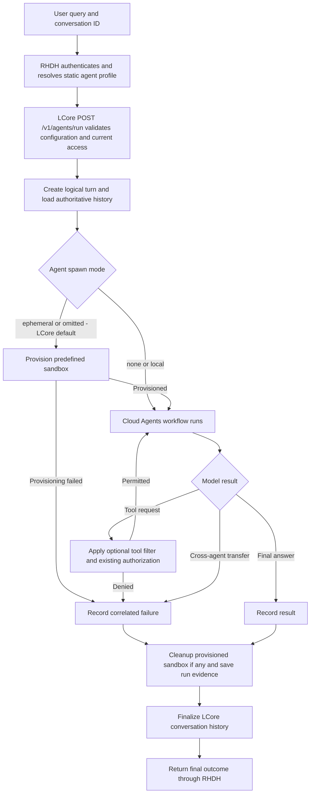

# Single agent workflow

Configuration validation accepts missing model, skill or tool bindings without inventing capabilities. An unavailable capability needed during execution produces a safe runtime failure. A sandbox (spawn `ephemeral`, set or defaulted) that cannot be provisioned stops the run without an unsandboxed fallback.
