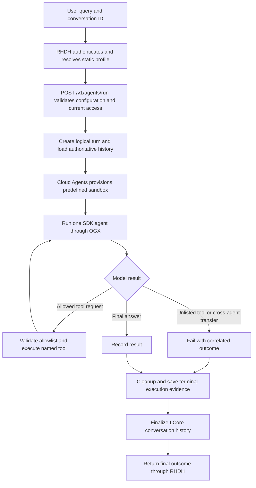

# Single agent workflow

Text/tool progress streams while execution runs. Success follows history finalization. Tool iterations do not create a second agent. Static bounds terminate loops; cancellation triggers cleanup and suppresses late output.
